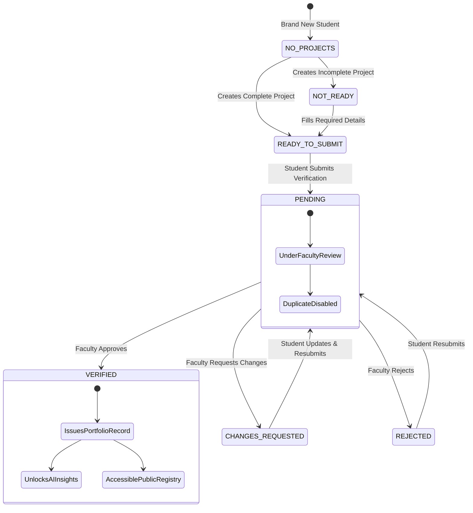

# VIDYALINK — Verification Workflow & State Machine Specification

## 1. Overview & Architecture Principle

Verification in VidyaLink is an authoritative, faculty-governed institutional trust mechanism. Under no circumstances does the system auto-verify accounts, projects, or portfolios upon creation, login, or route access.

### Core Invariants:
1. **Strict Database Authority**: Verification state is derived exclusively from persistent MongoDB records (`Verification`, `Project`, `Portfolio`). No client-side mock states or fallback badges exist.
2. **Faculty Exclusivity**: Only authenticated faculty (or administrative supervisors) can review, approve, request changes, or reject verification submissions.
3. **No Phantom Portfolios**: A student with zero verified projects/portfolios will never see a "Verified Portfolio" CTA.
4. **Duplicate Submission Protection**: Unique compound indices on `{ studentId, targetType, targetId }` where `status: 'PENDING'` prevent race conditions and duplicate submissions.
5. **Cryptographic Endorsement**: Faculty approval issues an immutable `Portfolio` credential record with a SHA-256 integrity hash and unique certificate ID (`VLC-YYYY-XXXX`).

---

## 2. State Machine

---

## 3. States & UI Behaviors

| Verification State | Dashboard Status Badge | Student Header CTA | Featured Project Card | Quick Action | Gating Restrictions |
|---|---|---|---|---|---|
| **NO_PROJECTS** | `Not submitted` (Slate) | `[Add Project]` (Primary) | "No projects added yet" + `[Add Project]` | `[Add Project]` | Portfolio route gated; AI analysis disabled |
| **NOT_READY** | `Not submitted` (Slate) | `[Complete Portfolio]` (Secondary) | Missing fields warning + `[Complete Portfolio]` | `[Complete Portfolio]` | Portfolio route gated; AI analysis disabled |
| **READY_TO_SUBMIT** | `Not submitted` (Slate) | `[Submit for Verification]` (Primary) | "No Verified Projects Yet" + `[Submit for Verification]` | `[Submit for Verification]` | Portfolio route gated; AI analysis disabled |
| **PENDING** | `Under Faculty Review` (Amber) | `[Verification Pending]` (Secondary, Disabled) | "Your project is currently pending faculty review" + `[View Projects]` | `[Verification In Review]` | Portfolio route displays "Verification In Progress" gate; AI disabled |
| **CHANGES_REQUESTED**| `Changes Requested` (Purple) | `[Review Changes]` (Primary) | Faculty remarks card + `[Update & Resubmit]` | `[Submit for Verification]` | Portfolio route displays "Changes Requested" gate; AI disabled |
| **REJECTED** | `Verification Rejected` (Rose) | `[Resubmit for Verification]` (Secondary) | Rejection remarks card + `[Resubmit for Verification]` | `[Submit for Verification]` | Portfolio route displays "Verification Rejected" gate; AI disabled |
| **VERIFIED** | `Verified` (Emerald) | `[Verified Portfolio]` (Secondary) | Real verified capstone card + `[Inspect Evidence]` | `[Verified Portfolio]` | Full portfolio access granted; AI analysis unlocked |

---

## 4. Eligibility Validation Engine

Before a student can trigger `submitVerification`:
- **Authentication**: Verified JWT session as student or admin.
- **Ownership**: Student must own the target project (`userId == req.user._id`).
- **Required Metadata**:
  - `title` (min 2, max 150 characters)
  - `shortDescription` or `description` (min 10 characters)
  - `technologies` / `techStack` (non-empty array)
- **Pending Conflict Prevention**:
  - Backend throws `409 Conflict` if target already has an open pending record.
  - Frontend disables duplicate submission CTAs and displays `Verification Pending`.

---

## 5. Faculty Review Actions & Database Mutations

When faculty reviews a project deliverable (`/faculty/verifications/:id`):

### A. Approval (`PATCH /api/v1/verification/:id/approve`):
1. Updates `Verification`: `status = 'VERIFIED'`, `facultyId`, `remarks`, `verifiedAt = new Date()`.
2. Updates `Project`: `verificationStatus = 'Verified'`.
3. Issues `Portfolio`:
   - Generates unique `certificateId` (`VLC-2026-XXXX`).
   - Computes SHA-256 hash: `hash(certificateId:studentId:projectId:timestamp)`.
   - Populates verified skills from project technologies.
4. Notification:
   - Recipient: `studentId`.
   - Title: `Verification Approved`.
   - Type: `verification`.

### B. Request Changes (`PATCH /api/v1/verification/:id/request-changes`):
1. Updates `Verification`: `status = 'CHANGES_REQUESTED'`, `facultyId`, `remarks` (required).
2. Notification:
   - Recipient: `studentId`.
   - Title: `Verification Changes Requested`.
   - Body contains faculty remarks.

### C. Rejection (`PATCH /api/v1/verification/:id/reject`):
1. Updates `Verification`: `status = 'REJECTED'`, `facultyId`, `remarks` (required).
2. Updates `Project`: `verificationStatus = 'Rejected'`.
3. Notification:
   - Recipient: `studentId`.
   - Title: `Verification Rejected`.
   - Body contains rejection explanation.

---

## 6. Access Control & Route Guarding

- **Direct URL Protection (`/portfolio`, `/portfolio/me`, `/portfolio/verified`)**:
  - Authenticated students without verified portfolios see an honest access-gate explaining their actual database state (`Pending review`, `Changes requested`, or `Not submitted`) with a navigation CTA to submit evidence or return to dashboard.
  - No fake certificates or fabricated hashes are ever rendered.
- **Public Credential Verification (`/portfolio/verify/:certificateId`)**:
  - Publicly accessible to recruiters and external reviewers.
  - Validates certificate ID against the database registry; returns 404 for invalid IDs.
- **AI Evaluation Gate (`/ai-insights`, `AIAnalysisPanel`)**:
  - Students without verified portfolios cannot run premature AI evaluations.
  - Button disabled with notice: `"Complete faculty verification before running AI evaluation."`
